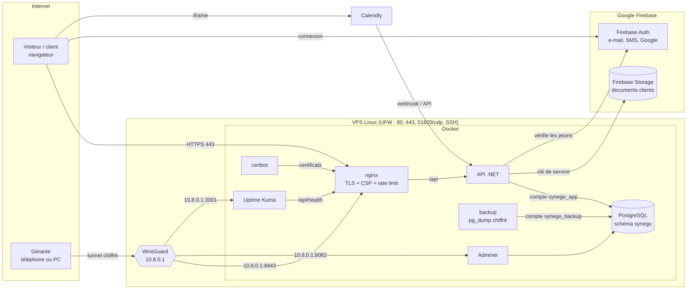

# Architecture

## Qui peut parler à quoi

| Depuis            | Vers                             | Port                 | Autorisé                                       | Pourquoi                                                           |
|-------------------|----------------------------------|----------------------|------------------------------------------------|--------------------------------------------------------------------|
| Internet          | nginx                            | 80, 443              | Oui                                            | Le site public et l'API publique                                   |
| Internet          | WireGuard                        | 51820/udp            | Oui                                            | Entrée du VPN (clé obligatoire)                                    |
| Internet          | SSH                              | 22                   | Oui au départ, puis **VPN uniquement**         | Administration du serveur                                          |
| Internet          | `/api/admin/*`                   | 443                  | Oui, rôle Coach (Non si `ADMIN_VPN_ONLY=true`) | Back-office du coach, derrière la connexion                        |
| Internet          | PostgreSQL, Adminer, Uptime Kuma | toutes               | **Non**                                        | Publiés sur 10.8.0.1 uniquement                                    |
| VPN (10.8.0.0/24) | back-office (nginx zone admin)   | 8443                 | Oui                                            | Accès alternatif (seul accès si `ADMIN_VPN_ONLY=true`)             |
| VPN               | Adminer, PostgreSQL              | 8082, 5432           | Oui                                            | Consultation avec le compte lecture seule                          |
| VPN               | Uptime Kuma                      | 3001                 | Oui                                            | Tableau de bord de surveillance                                    |
| VPN               | Mailpit                          | 8025                 | Oui                                            | E-mails de démonstration (tant qu'aucun SMTP réel n'est configuré) |
| API               | Serveur SMTP                     | 587                  | Oui                                            | Rappels de rendez-vous 48 h et 24 h avant                          |
| nginx             | API                              | 8080 (réseau Docker) | Oui                                            | Seul point d'entrée de l'API                                       |
| API               | PostgreSQL                       | 5432 (réseau Docker) | Oui, compte `synego_app`                       | Lecture/écriture des lignes, aucun droit sur la structure          |
| API               | Firebase Storage                 | 443                  | Oui, compte de service                         | Le navigateur n'accède jamais directement au bucket                |
| Navigateur        | Firebase Storage                 | 443                  | **Non** (règles `allow ... if false`)          | Voir `firebase/storage.rules`                                      |

**Attention Docker + UFW** : un port publié par Docker contourne UFW. C'est pour ça que
`compose.yaml` ne publie publiquement que 80/443 et lie tout le reste à `ADMIN_BIND_IP` (10.8.0.1).

## Comptes PostgreSQL

| Compte            | Utilisé par                         | Droits                                                     |
|-------------------|-------------------------------------|------------------------------------------------------------|
| `postgres`        | personne (initialisation seulement) | superutilisateur                                           |
| `synego_owner`    | conteneur `migrate`, restauration   | propriétaire du schéma `synego`                            |
| `synego_app`      | l'API                               | `SELECT/INSERT/UPDATE/DELETE` sur les tables, rien d'autre |
| `synego_backup`   | conteneur `backup`                  | lecture seule                                              |
| `synego_readonly` | l'équipe via le VPN (Adminer)       | lecture seule                                              |

Les droits sont posés par `deploy/postgres/init/01-roles.sh` et s'appliquent automatiquement
aux nouvelles tables (`ALTER DEFAULT PRIVILEGES`).

## Données

| Table                                                     | Contenu                                                                                           |
|-----------------------------------------------------------|---------------------------------------------------------------------------------------------------|
| `user_accounts`                                           | Compte applicatif lié à l'identité Firebase, rôle (Prospect, Client, Admin)                       |
| `appointments`                                            | Rendez-vous recopiés depuis Calendly (idempotent sur l'URI de réservation)                        |
| `client_documents`                                        | Métadonnées des documents, fichier dans le bucket sous un nom aléatoire                           |
| `tickets`, `ticket_messages`                              | Demandes de devis, de contact et de support, avec leur fil                                        |
| `client_notes`                                            | Notes privées du coach sur un client (jamais exposées au client, pas de données de santé)         |
| `courses`, `course_modules`, `lessons`                    | Formations en ligne : prix, publication, modules, leçons (texte, lien vidéo, aperçu gratuit)      |
| `enrollments`, `lesson_progress`                          | Accès d'un compte à une formation (achat, lien, offert) et leçons terminées                       |
| `community_posts`, `community_comments`, `post_reactions` | Communauté par formation et commentaires sous les leçons                                          |
| `payments`                                                | Paiements Stripe : achat, lien de paiement (jeton aléatoire), statut, moyen (carte, Klarna), reçu |
| `app_settings`                                            | Réglages du back-office (compte Calendly connecté, jeton chiffré, choix des événements)           |

Suppression d'un document : douce (`DeletedAt`), purge définitive après 30 jours. Une restauration
de la base fait donc réapparaître le document **et** son fichier. Fermeture de compte : suppression immédiate.

## Sécurité, en bref

- Connexion déléguée à Firebase : aucun mot de passe sur nos serveurs. L'API vérifie la signature
  de chaque jeton (`Authority = securetoken.google.com/<projet>`).
- Le rôle vient **toujours** de la base, jamais du jeton. Les e-mails `Admin__Emails` ne deviennent
  admin que s'ils sont vérifiés.
- Back-office : rôle Coach. Option `ADMIN_VPN_ONLY=true` : en plus, en-tête `X-Synego-Zone: admin` posé
  par le bloc nginx du VPN (le bloc public l'écrase), le back-office devient introuvable hors VPN.
- Fichiers : extension, taille (10 Mo) et signature réelle vérifiées ; noms aléatoires ; téléchargement
  uniquement par l'API, après contrôle du propriétaire.
- Formulaires publics : limités à 10 envois / 10 min / IP (API) et 10 req/s (nginx), champ piège anti-robots.
- Paiements : Stripe Checkout hébergé (carte, Apple Pay, Klarna) ; l'API relit chaque session chez Stripe,
  webhook signé (`Stripe-Signature`, 5 min) ; clé secrète et secret du webhook chiffrés (Data Protection) ;
  lien de paiement = jeton de 256 bits ; accès aux formations rattaché au compte, ou à une adresse e-mail vérifiée.
- Vidéos : seuls YouTube (sans cookie), Vimeo et Loom sont convertis en lecteur (liste blanche + CSP `frame-src`).
- Calendly : l'API ne lit que des URI `api.calendly.com` (pas de SSRF) ; webhook signé HMAC, valable 3 min.
- En-têtes : CSP stricte (Firebase + Calendly uniquement), HSTS, `X-Frame-Options`, `nosniff`.
- RGPD : pas de cookie publicitaire ni de mesure d'audience, polices auto-hébergées (pas de Google Fonts),
  suppression de compte en libre-service.
